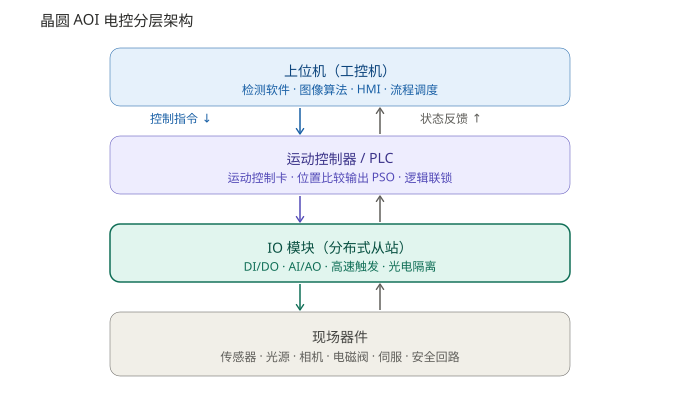
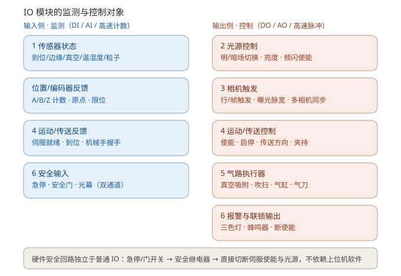
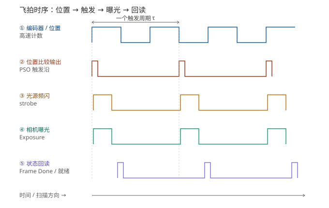

# 16 · 晶圆 AOI 设备 IO 模块：控制对象、时序与接口

> 面向设备工程视角，梳理晶圆外观/缺陷光学检测（AOI）设备中 IO 模块的定位、控制对象、信号流程与工程注意事项。
> 文中"IO 模块"泛指分布式 IO 从站（DI/DO/AI/AO + 高速触发口）及其配套的安全 IO，不含运动控制卡本身的插补运算。
> 配套阅读：14（AOI 缺陷清单 KLARF）、15（运动控制抽象层 `IMotionController`）。

---

## 1. 模块作用：整机的"神经末梢 + 手脚"

晶圆 AOI 的任务是：在晶圆高速扫描或逐场（field-by-field）成像过程中，把每一帧图像与精确的物理位置绑定，再判定缺陷。这个闭环里，上位机管"看和算"、运动控制器管"走位"，而 **IO 模块管"感知现场状态"和"把指令变成物理动作"**，具体承担四层职责：

- **电气隔离与电平转换**：现场多为 24 V 工业电平，控制器/相机多为 TTL/LVDS，IO 模块用光耦/数字隔离把强电侧噪声挡在逻辑侧之外，同时做 NPN/PNP、干接点/湿接点适配。
- **状态采集**：把传感器、限位、真空压力、安全门等信号实时上报，构成设备"可观测性"的基础。
- **功率驱动与执行**：小功率逻辑信号经晶体管/MOSFET/继电器放大后驱动电磁阀、光源、蜂鸣器、指示灯。
- **精密时序与联锁落地**：相机触发与光源频闪的亚毫秒级同步、急停/安全门的硬件级联锁，都由 IO（尤其是高速输出与专用安全 IO）最终兑现。

### 1.1 在整机架构中的位置

四层架构自上而下：**上位机（工控机，跑检测软件/算法/HMI）→ 运动控制器与 PLC → IO 模块（分布式从站）→ 现场器件**。指令经总线逐层下行，状态与反馈逐层上行。IO 模块正处在"逻辑域"与"物理域"的交界处，是二者唯一的标准接口。

> **工程事实**：真正的闪光/触发同步通常不经过普通 PLC 扫描周期，而是由运动控制器的位置比较输出（PSO, Position Synchronized Output）或 FPGA/高速 IO 直接驱动；普通 IO 负责的是"准备就绪、模式切换、低速连锁"这类毫秒级信号。把这两类信号混在同一张原理图里，是现场时序抖动最常见的根因。

---

## 2. 控制对象：每一类具体做什么

### 2.1 对象全景

按输入（监测）与输出（控制）划分，六类对象如下。

### 2.2 传感器状态监测（输入为主）

- **到位/存在检测**：漫反射或对射光电判断晶圆是否在上料位、卡匣/FOUP 是否到位、载盘有无；晶圆边缘位置传感器（EPD, Edge Position Detection）用于找正与边缘排除区判定。
- **真空压力**：真空表/压力开关（模拟量或开关量）确认吸附是否建立——这是吸取/放片动作能否继续的硬条件。
- **环境与过程量**：温度/湿度、洁净区粒子计数、气源压力、光源腔体温度，多为 4–20 mA 或 0–10 V。
- **位置反馈**：光栅尺/编码器 A/B/Z 由高速计数口读取，用于闭环定位与触发基准。

### 2.3 光源控制（输出为主）

- 明场/暗场、多波长通道的切换由 DO 控制；亮度由 AO 或 PWM 给定。
- **频闪（strobe）使能/触发**是关键：为冻结运动模糊、降低热漂移，光源只在曝光窗口内瞬时点亮，其脉宽与相机曝光严格对齐。

### 2.4 相机触发（高速输出，时序核心）

- 面阵相机：每个拍摄位由位置比较输出发一个 Frame Trigger，曝光脉宽由脉冲宽度或相机寄存器决定。
- 线扫 / TDI 相机：由编码器按行距连续发 Line Trigger，行频 = 扫描速度 ÷ 行间距。
- 多相机（明场+暗场、明场+暗场+背光）需要同一触发沿扇出，并做通道间延迟校准，否则同一物理位置的多通道图像会错位。

### 2.5 运动与传送机构

- **输出**：伺服使能、复位、正负限位旁路、传送带启停与方向、夹爪/顶升/对中气缸。
- **输入**：伺服就绪（SRV-ON）、原点、到位（INP）、报警、机械手"请求/允许/完成"握手信号——典型的是一套 request/acknowledge 状态机，避免"手还没退到位就走轴"的撞机。

### 2.6 气路执行器

- 真空电磁阀（吸附/破真空）、吹扫气刀（air knife）、N₂ 吹扫、离子风除静电、气浮台供气。
- 由 DO 驱动继电器/阀岛，配压力开关做"动作完成"反馈，形成"下令—确认"闭环。

### 2.7 报警与安全联锁

- 三色灯（红/黄/绿）、蜂鸣器、接触器/使能切断属于输出；急停、安全门、光幕、安全垫属于**双通道安全输入**。
- 安全链路走安全继电器或安全 PLC，直接使伺服处于 STO（Safe Torque Off）、切断光源电源；软件只在事后记录与提示，**不能把人身安全托付给上位机轮询**。

---

## 3. 控制流程：以"飞拍扫描一帧"为例看信号如何闭环

AOI 的关键流程不是"走—停—拍"，而是 **on-the-fly（飞拍）**：载台匀速运动过程中连续取像。

### 3.1 触发时序

对照时序图，一次完整控制流程分五个环节：

1. **准备就绪握手**：上位机下发"开始扫描"前，先轮询一组就绪条件——伺服 SRV-ON、原点已回零、真空压力达标、光源温度正常、相机 Link 正常、安全门关闭。任一不满足则挂起并点亮黄灯提示。
2. **触发链启动**：轴按设定速度匀速运动；编码器脉冲进入高速计数，位置比较器在到达预设位置区间时输出一个 PSO 触发沿（图中②）。
3. **同步执行**：同一触发沿同时驱动光源频闪（③）与相机曝光（④）——频闪窗口完全包住曝光窗口，保证图像是"冻结"的、无运动模糊。这一步必须是硬件级同步，不能用软件延时。
4. **状态回读与数据链路**：曝光结束后相机输出 Frame Done / 传输完成（⑤），上位机才算"拿到一帧有效图"；图像与触发时的位置标签绑定，供后续拼接与缺陷坐标映射。
5. **异常处理**：任一环节失败都有确定动作——触发超时未收到 Frame Done → 判定丢帧并重扫该位置；真空掉压 → 立即停轴、保持吸附或安全回落；编码器计数与指令位置偏差超阈值 → 跟随误差报警；急停/开门 → 硬件回路直接断使能，软件记录故障码。

### 3.2 三条工程原则

整个流程体现三条原则：

- **指令要确认**：command + acknowledge，不能"发了就当成了"；
- **动作要反馈**：sensor feedback，闭环而非开环盲控；
- **时序要硬件保证**：trigger in hardware，不依赖非实时操作系统调度。

---

## 4. 典型信号与接口

| 类别 | 信号/对象 | 电气形式 | 说明要点 |
|---|---|---|---|
| DI（数字输入） | 到位/原点/限位/真空开关/门磁 | 24 V，NPN/PNP，干/湿接点 | 加去抖滤波（ms 级）；安全信号用常闭（NC）故障安全 |
| AI（模拟输入） | 真空压力、温度、气源压力 | 4–20 mA / 0–10 V | 分辨率与采样率匹配过程量变化；做量程标定 |
| 高速输入 | 编码器 A/B/Z、光栅尺 | RS-422/LVDS 差分，MHz 级 | 四倍频计数，触发位置基准，走专用高速口而非普通 DI |
| DO（数字输出） | 电磁阀、继电器、三色灯、光源使能 | 24 V 晶体管/继电器输出 | 感性负载（线圈）必须加续流二极管；注意驱动电流余量 |
| AO / PWM | 光源亮度、比例阀 | 0–10 V / 4–20 mA / PWM | 亮度线性度影响成像一致性，需标定 |
| 高速输出 | 相机 Trigger、strobe、PSO | TTL/LVDS/光耦隔离，μs 级 | 与运动位置锁存，低抖动；多相机扇出做延迟校准 |
| 安全 IO | 急停、安全门、光幕、STO | 双通道 OSSD，安全继电器 | 独立于普通 IO，符合 ISO 13849 / IEC 61131-3 |
| 总线接口 | 分布式 IO 站点 | EtherCAT / PROFINET / Modbus TCP | 实时性、同步时钟（如 EtherCAT Distributed Clock）决定触发精度 |

---

## 5. 注意事项（工程落地要点）

- **强弱电与隔离**：24 V 现场侧与逻辑侧光耦隔离；模拟量用屏蔽双绞线、单点接地，避免地环路把伺服 PWM 噪声串进真空/温度读数。
- **触发精度是 AOI 的生命线**：位置比较到曝光的抖动直接变成图像错位与拼接缝。优先用带分布式时钟的总线或 FPGA 触发，避免经过 Windows/上位机软件路径。
- **频闪与曝光窗口匹配**：strobe 脉宽要覆盖曝光并留上升/下降沿余量，否则边缘行亮度不均；多通道光源做通道延迟标定。
- **故障安全（fail-safe）设计**：急停、门磁用常闭触点，断线即触发安全态；安全链走硬件回路，软件只做记录，切勿用轮询代替。
- **握手而非"盲发"**：机械手、传送、真空吸附都要 request/ack 或压力确认闭环，避免撞机与掉片。
- **可观测性与点表管理**：所有 IO 通道应有统一命名、状态可在 HMI 实时监控、故障可追溯到通道级；这也是后续做预测性维护（如阀动作次数、光源寿命）的数据基础。
- **负载与保护**：感性负载加吸收回路，输出留 20–30% 电流余量；长线驱动考虑压降与干扰。
- **时序变更要回归验证**：改扫描速度、行距或触发分频后，必须重标定触发延迟与位置标签，否则缺陷坐标会整体偏移。

---

## 6. 小结

IO 模块在 AOI 里不是一个"开关量中转站"，而是**把机械动作、光学成像与位置信息锁在同一时间基准上的接口系统**——它的设计质量直接决定图像能不能对得上、设备会不会撞、安全能不能兜住。

若要做具体的信号梳理或时序排查，应从三样东西入手：**点表（I/O list）、总线/触发拓扑、一次丢帧或错位的现场波形**。
