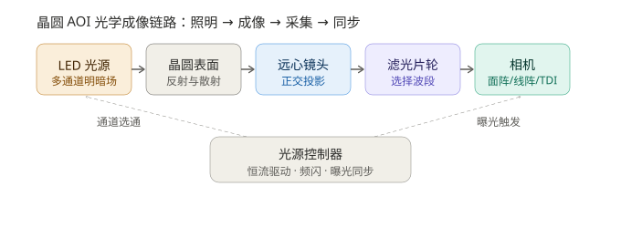
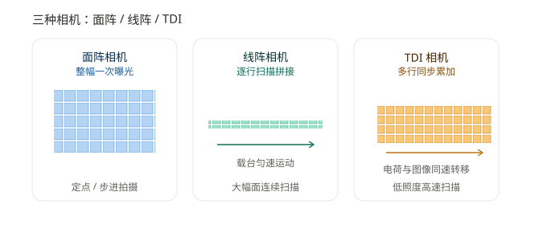
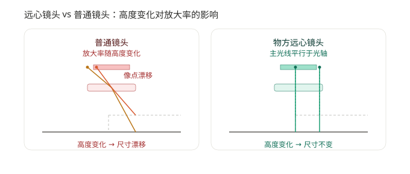
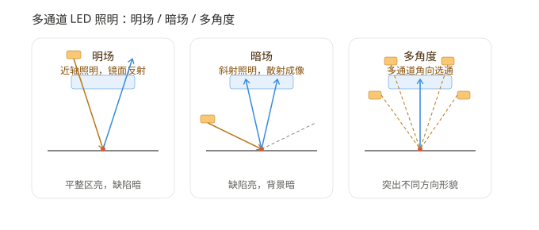
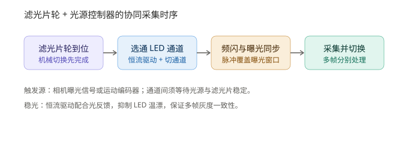

# 17 · 晶圆 AOI 光学成像：相机、镜头、光源与滤光片

> 面向设备/视觉工程视角，梳理晶圆外观与缺陷光学检测（AOI）的成像链：面阵 / 线阵 / TDI 相机、远心镜头、多通道 LED 光源（明场 / 暗场 / 多角度）、光源控制器与滤光片轮。
> 核心命题：把缺陷对光的反射/散射差异，转换成相机可测的灰度差异。
> 配套阅读：16（AOI 设备 IO 与控制对象时序）、18（光源控制器基础与操控）、11/14（KLARF 缺陷数据）。

---

## 1. 成像链总览

照明 → 晶圆表面 → 远心镜头 → 滤光片轮 → 相机，另由光源控制器负责通道选通与曝光同步。

四个环节各司其职：

- **照明**决定"缺陷显不显"——同样的颗粒，换个打光角度就可能从看不见变成很亮；
- **镜头**决定"量得准不准"——晶圆有翘曲和高度差，普通镜头会产生透视误差；
- **相机**决定"看多快多清"——面阵 / 线阵 / TDI 对应不同的扫描与灵敏度策略；
- **控制器与滤光片轮**决定"多通道数据能不能对齐可比"。

---

## 2. 相机：面阵 / 线阵 / TDI

| 类型 | 成像方式 | 关键优势 | 主要约束 | 典型用途 |
|---|---|---|---|---|
| 面阵 | 一次曝光整幅成像 | 算法简单、帧率高、易做多帧融合 | 视场与分辨率互相牵制 | Die 级外观、bump、宏观检查 |
| 线阵 | 随载台运动逐行扫描拼接 | 超宽幅面、纵向分辨率由运动决定 | 编码器同步与运动平稳性要求高，照明亮度要求高 | 整片扫描、边缘/倒角 |
| TDI | 多行像素随图像同速转移累加 | 高灵敏度、高速、低照度可用 | 行转移速度必须与图像速度严格匹配，失配拖影 | 高速暗场颗粒/划痕全检 |

- **面阵**：配步进载台做"拍照—移动—再拍照"。要在大视场下保留亚微米像元，就得上大靶面/高像素传感器，成本与数据量随之上升。
- **线阵**：横向分辨率由像元数与镜头决定，纵向由编码器触发精度决定；每行曝光时间很短，对光源亮度要求高。
- **TDI**：同一目标依次经过 N 行（常见 32/64/128 级），电荷或数字域同步累加，等效曝光延长 N 倍，散粒噪声受限下信噪比约提升 √N。暗场颗粒/划痕检测尤其受益；核心约束是速度匹配。

---

## 3. 远心镜头

普通镜头的放大率随物距变化：晶圆翘曲、bump/凹坑带来的高度差会让同一图形产生像点横向漂移、尺寸测不准。远心镜头把孔径光阑放在像方焦点，使物方主光线平行于光轴——在景深范围内，物体上下移动不改变放大率和位置。

- **物方远心**：消除高度变化引起的测量误差，检测主流。
- **双远心**（物方 + 像方）：同时保证像面照度均匀、对传感器倾斜不敏感，用于高精度量测。
- **代价**：口径大、工作距离长、价格高，NA 通常受限；分辨率按最小特征与像元尺寸匹配（常见 2–3 像素/最小特征），别只看"远心"标签而忽略 NA 与景深。
- **关键指标**：远心度（残余主光线倾角，如 <0.1°）、工作距离、景深、支持靶面尺寸。

---

## 4. 多通道 LED 光源

| 模式 | 光路 | 敏感缺陷 |
|---|---|---|
| 明场（同轴/近轴/低角度环形） | 平整区镜面反射进入镜头 → 亮；缺陷散射走 → 暗 | 图形缺陷、颗粒、色差/膜厚差异 |
| 暗场（高角度斜射） | 镜面反射偏离镜头，仅缺陷散射光被收集 → 暗背景亮缺陷 | 亚分辨率颗粒、细划痕、边缘毛刺 |
| 多角度/多色 | 穹顶多组 LED，按方位角、仰角、波长（UV/蓝/绿/红/白）分时点亮 | 方向性划痕、凸凹极性、材料差异 |

明场对镜面晶圆常用分光镜做同轴照明；暗场是晶圆表面全检的主力；多角度多帧融合能区分划痕方向、凸凹极性和材料差异，多色还能做初步光谱/颜色判别。

---

## 5. 光源控制器与滤光片轮

**光源控制器**：以恒流驱动保证 LED 光通量稳定（LED 亮度对电流极敏感，不合适的调光会带来频闪伪影），提供多通道独立电流、外触发/编码器触发、微秒级频闪、通道序列器，以及过流/过温保护。高端机型带光反馈闭环，用光电二极管监测实际光强并补偿温漂和老化——这是多帧灰度可比的前提。频闪脉宽必须覆盖相机有效曝光窗口，否则画面出现明暗条纹。

**滤光片轮**：装在镜头与相机之间（有时也在照明端），按需求切换带通/长通/短通/陷波/偏振/中性密度片。两个典型用途：分色/分波段多光谱判别；在 PL/荧光检测中用长通片挡激发光、只放行发光信号，或用偏振片抑制眩光。选型看：片数、切换速度与到位信号、中心波长/带宽/截止深度（OD 值）、透过率、口径与靶面匹配、镜片平行度。机械切换是毫秒到百毫秒级动作，必须等"到位"确认后再曝光。

---

## 6. 快速选型参考

| 检测任务 | 推荐组合 |
|---|---|
| 表面颗粒/划痕高速全检 | 线阵或 TDI + 暗场多角度 LED + 远心镜头 + 编码器触发 |
| bump 高度/共面度量测 | 面阵 + 双远心镜头 + 明场同轴/结构光 + 多频闪 |
| PL/EL 发光检测 | 面阵（高灵敏/制冷）+ 激发光源 + 长通/带通滤光片轮 + 暗场隔离 |
| 宏观外观/包装前检查 | 面阵 + 明场穹顶光 + 多色通道切换 |

一句话总结：**相机决定看多快多清，远心镜头决定量得准不准，光源决定缺陷显不显，控制器和滤光片轮决定多通道数据能否对齐可比。**
