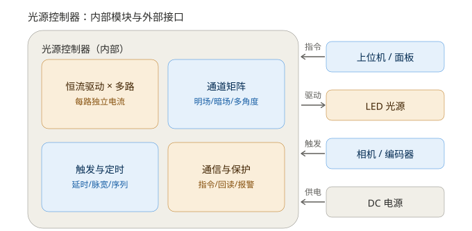
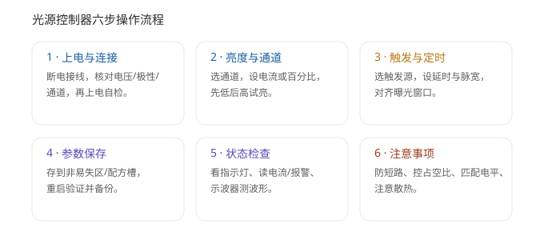
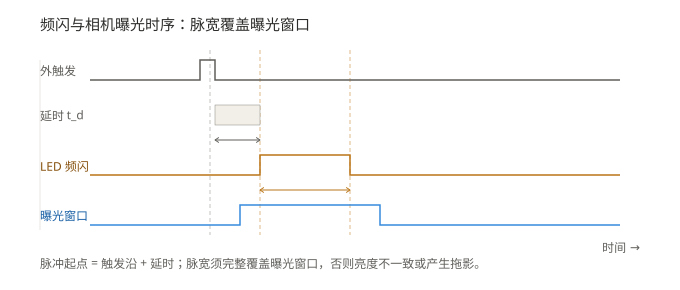

# 18 · 光源控制器：基本概念、类型、接口与操控

> 面向初学者与设备集成视角，先讲清光源控制器"是什么、做什么、有哪些形态和接口、用在哪"，再给出可照做的操控流程：上电与连接、亮度/通道调节、触发与定时、参数保存、状态检查、注意事项。
> 核心区分：亮度"由谁给"（面板 / 模拟量 / 数字指令）与"何时亮"（常亮 / 外部触发）是两件事。
> 配套阅读：16（AOI 设备 IO 与触发时序）、17（AOI 光学成像）、尤其是本文 §7 的时序图与 16 的飞拍时序对照看。

---

## 1. 基本概念

光源控制器（LED controller）是**给 LED 提供稳定电流、并按命令或时序开关/调节亮度的专用电源**。它不是普通电源适配器：LED 是电流型器件，亮度近似正比于正向电流，电流漂移会直接变成图像灰度漂移，所以控制器核心是**恒流驱动**，而不是恒压供电。

## 2. 作用

- **稳定光输出**：恒流驱动抑制温漂；高端机型带光反馈闭环，亮度不随 LED 老化/温度漂移。
- **多通道管理**：明场、暗场、各角度 LED 分通道独立设亮度、独立开关。
- **时序同步**：接受相机/编码器触发，做频闪（strobe）、延时、脉宽控制，把运动"冻结"在曝光瞬间。
- **保护与诊断**：过流、短路、过温保护；回读实际电流/电压、报警码。
- **参数存储**：把亮度组合和时序存成配方，换线/换产品时一键调用。

## 3. 常见类型

| 维度 | 类型 | 说明 |
|---|---|---|
| 通道数 | 1/2/4/8/16 路 | 每路电流从几十 mA 到数 A，按 LED 功率选 |
| 输出方式 | 连续 / 频闪 / 混合 | 频闪型允许短时大电流过驱，亮度更高 |
| 操作形态 | 面板旋钮式 / 软件式 / 模拟量式 | 决定"怎么调亮度" |
| 通信方式 | RS-232 / RS-485(Modbus RTU) / USB / 以太网(Modbus TCP) | 决定"上位机怎么接入" |
| 同步能力 | 无触发 / 外触发 / 序列触发 | 高速检测必须选带触发的 |

## 4. 主要接口

| 接口 | 作用 | 初学者要点 |
|---|---|---|
| 电源输入 | DC 24V/48V 等 | 电压、功率余量要够；注意极性 |
| LED 输出 | 接光源，每通道 +/- | **输出电压要匹配 LED 阵列正向压降**；严禁短路 |
| 触发输入 | 接相机 Strobe / 编码器 / 光电传感器 | 注意 TTL 3.3V/5V 或 24V 电平匹配；光耦隔离更抗干扰 |
| 通信口 | RS-232/485/USB/网口 | 地址、波特率、协议要和下位软件一致 |
| 模拟量输入 | 0–10V / 4–20mA | PLC 直接调光时用，抗干扰优于电压型 |
| 状态/报警 | LED 灯、报警输出、Ready | 用于联锁，判断"光源是否就绪" |

## 5. 典型应用场景

- **AOI / 晶圆检测**：暗场高频闪 + 多角度通道切换，与相机曝光严格同步。
- **尺寸量测**：明场同轴低噪声照明，恒流保证灰度稳定。
- **高速产线**：频闪冻结运动，避免拖影。
- **实验室/显微**：面板旋钮快速调亮度，多通道手动切换。
- **多光谱检测**：R/G/B/UV 通道按序点亮，配合滤光片轮多帧采集。

---

## 6. 如何操控

整个操控流程记成六步：

### 6.1 上电与连接

1. **先断电接线**：电源输入、LED 输出、触发线、通信线全部接好再上电。
2. **核对三件事**：电源电压与控制器额定一致；LED 阵列正向压降不超过控制器输出电压；每路 LED 的额定电流不超过该通道上限。
3. **极性**：LED 输出 +/- 接反不会亮，部分机型会报警；换光源后必须重设电流。
4. **上电自检**：观察电源灯、通道灯，看有无过流/短路报警；先设 5–10% 低亮度试亮，确认通道与光源一一对应。
5. **通信连接**：设置地址、波特率、协议（Modbus RTU/TCP），用软件读一次版本号确认握手成功。

### 6.2 亮度与通道调节

两种设定量要分清：**电流值（mA）**是物理量，**百分比（%）**通常是"该通道最大额定电流的百分比"，不是线性光通量——50% 电流不等于 50% 亮度（LED 有非线性）。

- **面板式**：选通道 → 旋钮/加减键 → 屏显确认。
- **软件式**：选中通道 → 写亮度寄存器（如 `CH1=120mA`）→ 立即生效。
- **模拟量式**：PLC 输出 0–10V 或 4–20mA 对应亮度，适合产线固定工艺。
- **多通道**：逐通道记录"明场 CH1=60%、暗场 CH2=80%、角度 CH3=45%"这类组合，存为配方。

调亮时看着相机画面：过曝会丢失缺陷灰度信息，暗场模式下背景应接近黑。

### 6.3 触发与定时

这是最关键也最容易出错的一步。先看清三种模式的区别：

| 模式 | 工作方式 | 适用场景 |
|---|---|---|
| 常亮 | 上电后持续输出 | 手动调焦、静态观察 |
| 外触发频闪 | 每个触发脉冲亮一次 | 相机拍照、运动物体冻结 |
| 序列触发 | 一次触发按序点亮多通道 | 多帧多角度/多色采集 |

需要设四个定时参数：**触发源**（相机 Strobe / 编码器 / 光电传感器）、**触发极性**（上升沿/下降沿）、**延时 t_d**（从触发沿到 LED 点亮）、**脉宽 t_w**（LED 点亮持续时间）。

脉宽必须覆盖相机曝光窗口，且尽量不超出。调试方法：让相机连续采集，用示波器同时看触发信号和 LED 输出，微调延时让脉冲居中落在曝光窗口内。脉宽太短→曝光不足、画面偏暗；脉宽超出曝光窗口→本帧外的光混入，运动场景下产生拖影。序列触发还要设置通道间隔和帧数，保证"一通道一帧"对齐。

### 6.4 参数保存

- 面板式通常按 `MENU → Save → 选槽位`，或快捷键 `F1/Save`；软件式调用写入非易失存储的命令。
- 把亮度组合、触发模式、延时/脉宽、序列配置一起存成一个**配方（recipe）**，按产品型号/工位命名。
- **重启验证**：保存后断电再上电，确认参数保持；否则可能只改了 RAM 没写 Flash。
- 上位机软件导出配置文件备份，换机/返修后可直接恢复。

### 6.5 状态检查

| 检查项 | 怎么看 | 判断标准 |
|---|---|---|
| 电源/通道指示灯 | 面板观察 | 电源常亮，工作通道指示正确 |
| 电流/电压回读 | 软件读寄存器 | 与设定值偏差在允许范围 |
| 报警码 | 面板/软件 | 无过流、短路、过温 |
| 触发计数 | 软件 | 与拍照次数一致，不丢触发 |
| 实际波形 | 示波器 | 脉宽、延时与设定一致，无抖动 |
| 光反馈读数 | 闭环机型 | 稳定在目标值附近 |

### 6.6 常见注意事项

- **严禁短路**：LED 输出短路会烧毁通道；接线时断电操作。
- **控制占空比**：频闪瞬时电流可数倍于额定值，但必须遵守手册的最大占空比/平均电流限制，否则 LED 快速光衰。
- **散热**：大功率控制器和 LED 都要留出散热空间，禁止遮挡风道；过温保护触发后先降温再使用。
- **电平匹配**：相机 Strobe 是 3.3V 而控制器要求 5V/24V 时，需用电平转换或光耦隔离模块。
- **触发来源冲突**：同一时刻只保留一个触发源（相机或编码器），避免重复触发。
- **换光源重设电流**：不同 LED 的正向压降和额定电流不同，换型号后必须重新设定上限。
- **强光防护**：UV/高亮光源避免直视，调试时降低亮度。

---

## 7. 不同控制方式的主要差异

核心区别在两点：**亮度是谁给的**（面板/模拟量/数字指令）和**什么时候亮是谁决定的**（常亮/外部触发）。

| 控制方式 | 亮度设定 | 同步能力 | 精度/重复性 | 适合 |
|---|---|---|---|---|
| 面板旋钮 | 手动 | 无或简单触发 | 低，靠人眼 | 实验室、调试 |
| 模拟量 0–10V/4–20mA | PLC 电压/电流 | 无 | 中，受线缆干扰 | 产线固定工艺 |
| RS-232/485 指令 | 上位机软件 | 可带触发 | 高，可回读 | 设备集成、多配方 |
| 以太网/USB | 上位机软件 | 可带触发 | 高，可远程 | 多设备、集中管理 |
| 外触发频闪 | 常与数字方式叠加 | **微秒级同步** | 高 | AOI、高速检测 |

一句话：**面板解决"手动方便"，模拟量解决"PLC 直连"，数字接口解决"可编程和配方管理"，硬件触发解决"和相机严格同步"**。实际 AOI 设备通常是"数字接口设亮度 + 硬件触发定时刻"的组合，两者不是二选一。

建议初学者从面板式或带软件的入门机型入手，先练"单通道低亮度点亮 → 读回电流 → 存配方 → 断电重启验证"这条闭环，再上触发和序列功能。
