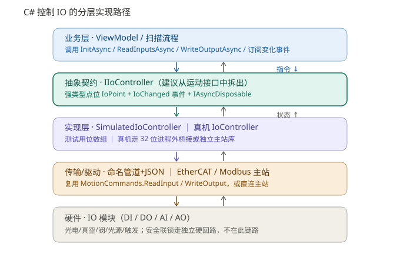
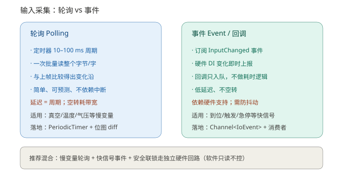

# 19 · 用 C# 控制 AOI 的 IO 模块：实现方案

> 承接 16（IO 模块的控制对象与时序）。本篇回答"如何用代码真正驱动这些 IO"。
> 覆盖：模块初始化、输入读取、输出控制、轮询/事件、地址点位映射、错误处理、资源释放。
>
> **本文是方案骨架，非最终实现。** 仓库当前没有任何具体 IO 模块型号、通信协议依赖或点表文档，
> 只有一套可复用的契约：`IMotionController.ReadInputAsync/WriteOutputAsync(int)`、
> `MotionIpcContracts` 中的 `ReadInput`/`WriteOutput` 命令与 DTO、模拟器的 `bool[64]` 位数组。
> 因此下面代码做成"传输无关"的桥接式，型号确认后只需替换两个核心方法。

---

## 0. 必须先确认的关键参数

型号 / 协议 / 点表这三项不确认，实现会锁死错误假设。按优先级：

| # | 参数 | 为什么决定实现方式 | 暂缺时的默认假设 |
|---|---|---|---|
| 1 | IO 模块厂商/型号（ACS? 倍福 EL 系列? 雷赛? 研华?） | 决定用哪个 SDK、能否走现有 ACS 桥接 | 先用模拟器 |
| 2 | 通信协议与物理接口（EtherCAT / Modbus TCP / PROFINET / 串口 / PCIe 板卡） | 决定驱动层、实时性与触发精度 | 假设 EtherCAT 从站 |
| 3 | 点表 I/O list（语义名 / 逻辑通道 / 物理地址 / 有效电平 / 初值） | 决定地址映射与代码可读性 | 用示例点表占位 |
| 4 | DI/DO 通道数与编址规则（从 0 还是 1 起、位序） | 决定数组边界与偏移换算 | 64 点，0-based |
| 5 | 输入有效电平（NPN/PNP、NO/NC）与去抖时间 | 决定是否逻辑取反、滤波参数 | 高有效、5 ms |
| 6 | 输入采集方式：模块是否支持变化中断/事件上报 | 决定轮询还是事件 | 两者都实现 |
| 7 | 是否含 AI/AO（真空压力、光源亮度、比例阀） | 现有接口只有 DI/DO，需扩展 | 一期只做 DI/DO |
| 8 | 高速触发（PSO / strobe / 相机 Trigger）走同一模块还是独立通道 | 决定能否纳入普通 IO 抽象 | 独立于普通 IO |
| 9 | 安全 IO（急停/门/光幕）是否纳入软件读取 | 安全链必须独立，一般不进此抽象 | 不纳入 |
| 10 | 目标扫描节拍与 IO 响应上限 | 决定轮询周期与看门狗阈值 | 轮询 20 ms |

---

## 1. 分层实现路径



五层自上而下：**业务层（ViewModel/扫描流程）→ 抽象契约 `IIoController` → 实现层（模拟器/真机）→ 传输驱动（命名管道或主站库）→ 硬件 IO 模块**。指令下行、状态上行。

**关键决策点**：现有 `IMotionController` 已塞入 `ReadInputAsync/WriteOutputAsync(int channel)`，IPC 也按裸通道号传输。能跑通，但有两个隐患：

- 裸 `int` 没有语义（`channel=7` 是真空还是光源？）；
- 只有单点读写，20 ms 轮询 40 个点要 40 次往返。

因此建议**从运动契约中拆出独立的 `IIoController`**，用强类型点位 + 批量读取。运动接口里的两个方法可保留作兼容，逐步只留 PSO 触发相关。

---

## 2. 点位映射：从裸 `int` 升级到强类型点表

```csharp
public enum IoPoint { WaferPresent, VacuumOk, LightReady, ServoReady,
                      LightStrobeEn, VacuumValve, StackLightRed, /* ... */ }

public sealed record IoPointDef(
    IoPoint Point, IoDirection Direction, int Byte, int Bit,
    bool ActiveLow, bool InitialValue, string Description);

// 语义点 → 物理地址：逻辑位号 = Byte*8 + Bit，ActiveLow 决定是否取反
public sealed class IoPointMap
{
    private readonly Dictionary<IoPoint, IoPointDef> _byPoint;
    private readonly Dictionary<int, IoPointDef> _byOffset;

    public bool Decode(IoPoint p, byte[] frame) =>
        _byPoint.TryGetValue(p, out var d)
            ? ((frame[d.Byte] >> d.Bit) & 1) ^ (d.ActiveLow ? 1 : 0) == 1
            : throw new IoPointNotFoundException(p);

    public static IoPointMap Load(string json) => /* System.Text.Json 反序列化 + 校验重复偏移 */;
}
```

三层映射链：**语义点（IoPoint）→ 字节/位（Byte, Bit）→ 物理电平（ActiveLow 取反）**。点表用 JSON 外部化，启动时校验重复偏移，对应 16 篇强调的"点表管理"。

---

## 3. 契约：`IIoController`（与 `IMotionController` 并列，不合并）

```csharp
public interface IIoController : IAsyncDisposable
{
    IoConnectionState State { get; }
    event EventHandler<IoChangedEventArgs>? InputChanged;   // 变化沿（轮询 diff 或硬件中断都走这里）
    event EventHandler<IoFaultEventArgs>? Faulted;

    Task InitializeAsync(IoConnectionOptions options, IoPointMap map, CancellationToken ct = default);
    Task<byte[]> ReadInputsAsync(CancellationToken ct = default);          // 批量：一次读整帧
    bool Read(IoPoint point);                                              // 从本地缓存读，零 IO
    Task WriteAsync(IoPoint point, bool value, CancellationToken ct = default);
    Task WriteBatchAsync(IReadOnlyDictionary<IoPoint, bool> values, CancellationToken ct = default);
    Task StartMonitoringAsync(TimeSpan pollInterval, CancellationToken ct = default);
}
```

---

## 4. 初始化 → 读取 → 写出 → 轮询/事件 → 释放（完整闭环）

```csharp
public sealed class BridgeIoController : IIoController
{
    private readonly IIoTransport _transport;          // 命名管道 / EtherCAT 主站 / Modbus
    private IoPointMap _map = null!;
    private byte[] _inputFrame = [];                   // 最新输入镜像
    private CancellationTokenSource? _monitorCts;
    private Task? _monitorTask;
    private bool _disposed;

    public async Task InitializeAsync(IoConnectionOptions o, IoPointMap map, CancellationToken ct)
    {
        ObjectDisposedException.ThrowIf(_disposed, this);
        _map = map;
        await _transport.ConnectAsync(o.Endpoint, ct);          // 建链
        var identity = await _transport.ReadIdentityAsync(ct);  // 校验模块型号/固件
        if (!o.AcceptedModels.Contains(identity.Model))
            throw new IoModelMismatchException(identity.Model, o.AcceptedModels);
        _inputFrame = await _transport.ReadInputsAsync(ct);     // 建立初始镜像
        await SafeOutputsAsync(ct);                              // 所有 DO 置安全态
        State = IoConnectionState.Ready;
    }

    public async Task<byte[]> ReadInputsAsync(CancellationToken ct = default)
    {
        EnsureReady();
        var frame = await _transport.ReadInputsAsync(ct);       // 一帧读全部 DI
        ApplyDebounceAndRaise(frame);                            // 去抖 → diff → InputChanged
        return frame;
    }

    public bool Read(IoPoint p) => _map.Decode(p, _inputFrame);  // 只查缓存，不碰硬件

    public async Task WriteAsync(IoPoint p, bool value, CancellationToken ct = default)
    {
        EnsureReady();
        var d = _map.Require(p);
        if (d.Direction != IoDirection.Output) throw new IoDirectionException(p);
        await _transport.WriteOutputAsync(d.Byte, d.Bit, value ^ d.ActiveLow, ct);
        // 写后回读确认（关键输出如光源/阀必须做）
        var echo = await _transport.ReadOutputAsync(d.Byte, d.Bit, ct);
        if ((bool)echo != value) throw new IoWriteVerifyException(p);
    }

    public Task StartMonitoringAsync(TimeSpan interval, CancellationToken ct = default)
    {
        _monitorCts = CancellationTokenSource.CreateLinkedTokenSource(ct);
        _monitorTask = Task.Run(async () =>
        {
            using var timer = new PeriodicTimer(interval);
            while (await timer.WaitForNextTickAsync(_monitorCts.Token))
            {
                try { await ReadInputsAsync(_monitorCts.Token); }
                catch (OperationCanceledException) { throw; }
                catch (Exception ex) { Faulted?.Invoke(this, new(ex)); }  // 不退出循环
            }
        }, _monitorCts.Token);
        return Task.CompletedTask;
    }

    public async ValueTask DisposeAsync()
    {
        if (_disposed) return;
        _disposed = true;
        _monitorCts?.Cancel();                       // 停轮询
        if (_monitorTask is not null) try { await _monitorTask; } catch (OperationCanceledException) { }
        try { await SafeOutputsAsync(default); } catch { /* 记录，不阻断 */ }
        await _transport.DisconnectAsync(default);
        _monitorCts?.Dispose();
        GC.SuppressFinalize(this);
    }

    private void ApplyDebounceAndRaise(byte[] frame)
    {
        // 逐点去抖（连续 N 帧一致才认）→ 与旧镜像异或 → 触发 InputChanged
        var old = _inputFrame; _inputFrame = frame;
        foreach (var p in _map.Points.Where(p => _map.Require(p).Direction == IoDirection.Input))
            if (_map.Decode(p, old) != _map.Decode(p, frame))
                InputChanged?.Invoke(this, new(p, _map.Decode(p, frame)));
    }
}
```

---

## 5. 轮询 vs 事件



- **轮询**：`PeriodicTimer` 周期批量读整帧 → 与上帧 diff → 变化沿上报。简单、可预测、不依赖硬件中断；延迟 = 周期，空转耗带宽。适用真空/温度/气压等慢变量。这正是模拟器 `_tickInterval = 20ms` 的语义。
- **事件**：订阅硬件 DI 变化中断，回调只把事件塞进 `Channel<IoEvent>`，消费者单独处理。低延迟、不空转；依赖硬件支持且需防抖。适用到位/触发/急停等快信号。
- **推荐混合**：慢变量轮询 + 快信号事件 + 安全联锁走独立硬件回路（软件只读不控）。

---

## 6. 七项要求的落点对照

| 要求 | 实现要点 | 现有代码可复用处 |
|---|---|---|
| 模块初始化 | 建链→校验型号/固件→建输入镜像→**DO 先置安全态**→Ready | `ConnectAsync` 状态机、`MotionConnectionState` |
| 输入读取 | 批量 `ReadInputsAsync` 读整帧，业务用 `Read(point)` 查缓存零开销 | 模拟器的 `bool[64]` 可换为 `byte[]` 帧 |
| 输出控制 | 方向校验→带极性写出→**回读确认**（光源/真空阀必做） | `WriteOutputAsync` + `WriteOutputRequest` DTO |
| 轮询/事件 | `PeriodicTimer` 批量轮询 + diff 上报 `InputChanged`；有中断时改走 `Channel<IoEvent>` | 模拟器的 20ms 轮询节奏 |
| 地址/点位映射 | `IoPointMap` 三层：语义点→字节/位→极性；JSON 点表 + 启动校验 | 新增，补现有裸 `int` 的短板 |
| 错误处理 | 未就绪/方向错/型号不符/写校验失败各自异常；轮询异常上报 `Faulted` 不退出 | `MotionIpcResponse.ErrorCode/ErrorMessage` 可复用 |
| 资源释放 | `IAsyncDisposable`：取消并等待轮询任务→输出归安全→断链→`SuppressFinalize` | 接口已具备 `IAsyncDisposable` |

---

## 7. 三条工程红线

1. **初始化和释放都要把 DO 置安全态**（光源灭、阀断），防止残留输出导致误动作。
2. **轮询循环的异常只能上报不能退出**，否则设备会"静默失明"。
3. **急停/安全门只读不控**，绝不进 `WriteAsync` 链路；安全链走独立硬件回路。

---

## 8. 落地待办（型号确认后）

- [ ] 按 `AGENTS.md` 归属规则新建 `src/WaferMapStudio.Io/`（纯 net10.0 契约层）与 `tests/WaferMapStudio.Io.Tests/`；
- [ ] `E142Transfer.slnx` 的 src/tests 分组各加对应项目；
- [ ] 真机实现放进程外桥接（复用 ACS x86 服务）或独立主站库，视协议而定；
- [ ] `AppServices.cs` 集中注册 DI；
- [ ] 跑通 `dotnet build E142Transfer.slnx -c Release` 0 警告、`dotnet test` 全绿；
- [ ] 版本号只在 `Directory.Build.props` 改一处。
