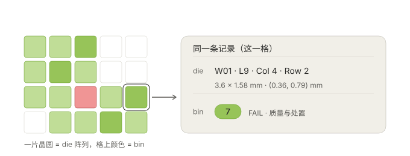
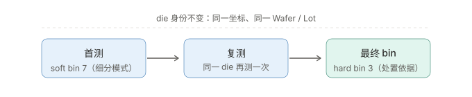

# 20 WorkBuddy 分享：介绍半导体行业点墨概念（die 与 bin 的关系）

[返回索引](./README.md)

> **来源**：WorkBuddy 发布页「介绍半导体行业点墨概念」
> **链接**：https://workbuddy.link/p/X0YPJDp4IgRu4EMHmmhhD3?shareId=6f650295-28bd-494b-8b0b-062cfaa89eb5&ext2=copy_link
> **原始问题**：die 和 bin 是什么关系，分别代表什么？
> **归档时间**：2026-11-17
> **说明**：分享页标题为「介绍半导体行业点墨概念」，正文实际是围绕 die / bin 的一轮问答。下面按分享页原顺序整理，两张内嵌示意图已本地化为 `images/` 下的独立 SVG（原图依赖页面注入样式，此处已补齐自包含样式，浅色主题下可直接打开）。

## 内容摘要

- die 是晶圆上的实体格位，bin 是该格位的判定分类。
- 一张 wafer map 记录的是「die 格位 → bin 值」的映射。
- 同一 die 身份不变，bin 会随测试轮次和工序改变。
- Null、Marked、无 bin 图、文件私有码是四类高频边界陷阱。
- 代码里 `DieVisual` 前两字段是身份，后三字段是判定与解释。

## 正文

die 可以理解为晶圆上的一个"对象"，bin 则可以理解为对这颗芯片给出的"判定"。一张 wafer map 本质上是一张映射表，记录的是 `die 的格位 → bin 值`。

左侧每个格位代表一颗 die，它相当于一个"地址"；格上的颜色和数值就是这颗 die 的 bin，也就是"结论"。右侧是同一格在 map 文件中的真实记录：前半段是 die 的身份字段，后半段是 bin 的判定值。二者字段性质不同，在规范中属于不同层级。

| | die | bin |
|---|---|---|
| 是什么 | 晶圆上的一颗独立芯片或器件（DUT），有物理位置和尺寸 | 判定结果的**分类编号**，本质是分箱：bin 的字面意思就是"箱子" |
| 由谁产生 | 晶圆本身（设计、pitch、die size 决定格位） | 测试程序或设备写入（探针台、AOI、终测、目检） |
| 唯一性 | 由 `Wafer + Lot + (Col,Row)` 或 `(X,Y)` 唯一确定一颗 | 一个 bin 码代表"一类结果"，上万颗 die 可共用同一个 bin |
| 可变性 | 不变（切割、扩晶后仍可追溯回溯） | 会变：首测、复测、换测试程序或换工序都可能不同 |
| 粒度 | 物理实体，一颗一颗 | 判定类别，配一张 **bin 表**（码 → 名称、质量、颜色、处置方式） |

关系可以用三个视角精确表述：

1. **数据视角（一对一）**：map 中一条记录 = 一颗 die 的坐标 + 一个 bin 值。"每颗 die 一个 bin"只在这一份文件、这一次测试内成立。
2. **语义视角（主谓）**：die 是主语，bin 是谓语结果。die 回答"哪一颗"，bin 回答"好不好、为什么不好、怎么处置"。bin 表是 map 级字典，不属于单颗 die。
3. **时间视角（一对多）**：同一颗 die 在生命周期里有多条 bin 记录。这一条最容易被忽略：

这几条边界在工程里确实会导致错误；你仓库里基本都遇到过：

- **空位（Null bin）**：格位存在但没有 die（晶圆边缘弧形区）。E142/G85 用 `NullBinCode=255` 表示"这个位置没有 die"；TSK DAT 的空位 bin 字节也是 `0`，与 GOOD 同码，直接投影会把空位算成良品，所以 `TskDatReader` 特意不给空位赋 bin 码。判断"有没有 die"要用 `BinCode` 和真实 die 标志一起看。
- **Marked（有 die、有 bin、未判定）**：G85 样本里 4463 颗 `BinQuality=None` 的 Camtek Marked。它既不是 Null（有实体），也不是 Pass（未判定），必须单列一类，否则良率两头都错。
- **根本没有 bin 的 die 图**：KLARF 只有 die 坐标和缺陷，没有 bin。die 的类别得靠缺陷聚合反推（有缺陷 → Fail），这是"bin 缺失，只能由缺陷代偿"的典型。
- **bin 语义是文件私有的**：同一个码在不同文件可能完全相反（你 02B4 首测 GOOD=bin30 落在 TEST_ZONE，复测 GOOD=bin0），所以 bin 表（E142 的 BinCodeMap、TSK 配对的 XTR）必须跟 map 一起读，不能跨文件套用。

落到代码就是这句关系的一行：`DieVisual(Col, Row, BinCode, Category, Description)` —— 前两个字段是 die 的**身份**，后三个是 bin 的**判定与解释**。`NeutralBinDefinition(Code, Description, Class)` 是那张 bin 字典，`BinColorPalette` 只按 bin 上色（同类别不同码 = 同色系不同深浅），良率、类别分布也都是按 bin 聚合出来的，不是按 die。

一句话记忆：**die 是格子，bin 是格子里的字；格子不动，字可以改写。**

## 与本知识库的关系

- 点墨的来龙去脉 → [01 点墨（Inking）与 EDS 流程](./01-点墨-Inking-与EDS流程.md)：本文的 die / bin 正是"数据墨点"的两端。
- hard bin / soft bin 的编码规则 → [02 Bin 编码规则](./02-Bin编码规则-hard-soft-bin.md)：对应时间视角里的首测 / 复测 / 最终 bin。
- 码值到语义的映射 → [03 BinCode](./03-BinCode-码值到语义的映射.md)：对应"bin 表是 map 级字典"。
- 工程落地 → [09 E142Transfer 适配器](./09-工程实现-E142Transfer适配器.md)：`DieVisual` / `NeutralBinDefinition` 所在层。
- 边界陷阱的真实样本 → [12 SEMI G85](./12-SEMI-G85-格式与Amkor样本接入.md)（Marked）、[13 TSK DAT](./13-TSK探针台DAT格式详解.md)（空位与 bin 漂移）、[14 KLARF AOI](./14-KLARF-AOI缺陷清单样本解析.md)（无 bin 图）。
