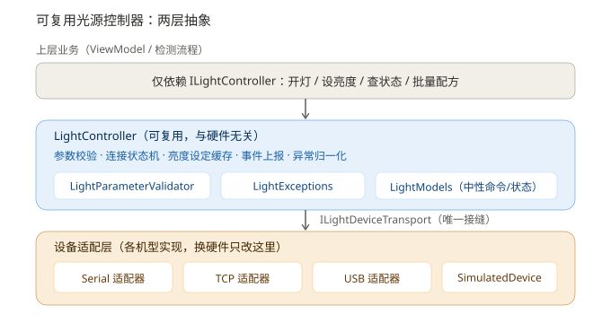

# 21 · 可复用光源控制器抽象层（C# 实现）

> 面向上位机工程视角：在不绑定具体硬件协议的前提下，封装光源开关、亮度/强度设置、状态查询、参数校验与异常处理；把底层设备通信抽成接口，便于后续接入真实硬件。
> 落地项目：`src/WaferMapStudio.Lighting`（纯 `net10.0` 契约层）+ `tests/WaferMapStudio.Lighting.Tests`（15 个单测）。
> 配套阅读：16（AOI IO 与触发时序）、18（光源控制器基础与操控）、15（运动控制抽象层，同样设计思路）。

---

## 1. 设计要点：为什么分两层

把"控制逻辑"和"设备通信"拆开，是这个抽象层的核心。



| 层 | 类型 | 职责 | 不负责 |
|---|---|---|---|
| 业务上层 | `ILightController` | 意图级操作：开灯、设亮度、查状态、批量配方 | 协议帧、校验、超时重试 |
| 可复用控制器 | `LightController` | 参数校验、连接状态机、亮度缓存、事件、异常归一化 | 字节编码、电气量换算 |
| 设备适配 | `ILightDeviceTransport` | 中性命令 ↔ 设备帧；单位换算、校验和、重试 | 业务判断、合法性校验 |

这样换硬件只需新增一个 `ILightDeviceTransport` 实现并注入，`ViewModel`/检测流程一行不改。与 15 号文档的运动控制抽象层是同一套思路。

---

## 2. 类结构一览

| 文件 | 类型 | 作用 |
|---|---|---|
| `ILightDeviceTransport.cs` | 接口 | **最关键的接缝**：连接、读能力、写通道、读状态 |
| `ILightController.cs` | 接口 | 上层唯一依赖的控制器契约 |
| `LightController.cs` | 类 | 可复用实现：校验 + 状态 + 缓存 + 事件 + 异常 |
| `LightParameterValidator.cs` | 静态类 | 集中式参数校验（通道/亮度/电流/过渡） |
| `LightExceptions.cs` | 异常族 | `LightControllerException` 及三种派生异常 |
| `LightModels.cs` | record/类 | 连接参数、命令、状态快照、设备能力、事件参数 |
| `LightEnums.cs` | 枚举 | 链路/通道状态、强度单位、过渡方式、链路类型 |
| `SimulatedLightDevice.cs` | 类 | 无硬件模拟器，同时是适配器编写范本 |
| `LightControllerFactory.cs` | 接口+类 | DI 工厂，隔离具体实现 |

### 2.1 底层通信接口（硬件接入点）

```csharp
public interface ILightDeviceTransport : IAsyncDisposable
{
    LightConnectionState ConnectionState { get; }
    event EventHandler<LightConnectionChangedEventArgs>? ConnectionStateChanged;

    Task ConnectAsync(LightConnectionOptions options, CancellationToken ct = default);
    Task DisconnectAsync(CancellationToken ct = default);
    Task<LightDeviceCapabilities> ReadCapabilitiesAsync(CancellationToken ct = default);

    // 中性命令：只表达"哪个通道、目标亮度、过渡方式"，不规定协议帧
    Task SetChannelAsync(int channel, LightChannelCommand command, CancellationToken ct = default);
    Task SetChannelsAsync(IReadOnlyDictionary<int, LightChannelCommand> commands, CancellationToken ct = default);

    Task<LightChannelStatus> ReadChannelAsync(int channel, CancellationToken ct = default);
    Task<IReadOnlyList<LightChannelStatus>> ReadAllChannelsAsync(CancellationToken ct = default);
}
```

实现方负责：把 `LightChannelCommand` 翻译成 Modbus 寄存器 / 串口 ASCII / 厂商协议帧，做字节序、校验和、超时重试、DAC 码值与 mA 的换算。**明确不做**参数校验与状态语义——那是控制器的职责。

### 2.2 上层控制器契约

```csharp
public interface ILightController : IAsyncDisposable
{
    LightConnectionState ConnectionState { get; }
    LightDeviceCapabilities? Capabilities { get; }
    IReadOnlySet<int> AvailableChannels { get; }

    event EventHandler<LightChannelChangedEventArgs>? ChannelChanged;
    event EventHandler<LightFaultEventArgs>? Faulted;
    event EventHandler<LightConnectionChangedEventArgs>? ConnectionStateChanged;

    Task ConnectAsync(LightConnectionOptions options, CancellationToken ct = default);
    Task DisconnectAsync(CancellationToken ct = default);
    Task SetOnAsync(int channel, bool isOn, CancellationToken ct = default);
    Task SetBrightnessAsync(int channel, double percent, LightRampMode ramp = LightRampMode.Immediate,
                            int rampMilliseconds = 0, CancellationToken ct = default);
    Task SetIntensityAsync(int channel, double value, LightIntensityUnit unit, CancellationToken ct = default);
    Task SetBrightnessBatchAsync(IReadOnlyDictionary<int, double> brightnessByChannel, CancellationToken ct = default);
    Task TurnOffAllAsync(CancellationToken ct = default);
    Task<LightChannelStatus> ReadChannelAsync(int channel, CancellationToken ct = default);
    Task<IReadOnlyList<LightChannelStatus>> ReadAllChannelsAsync(CancellationToken ct = default);
}
```

---

## 3. 关键实现

### 3.1 参数校验先于设备访问

所有非法值在进入传输层之前被拦下，避免把 NaN 或越界值发给 DAC。校验规则集中在 `LightParameterValidator`，边界为：通道 `1..ChannelCount`、亮度 `0..100` 且必须有限值、电流 `0..MaxCurrentMa`、过渡时长 `0..60000 ms` 且设备需支持。

```csharp
public static void ValidateCommand(int channel, LightChannelCommand command,
                                   LightDeviceCapabilities capabilities)
{
    ArgumentNullException.ThrowIfNull(command);
    ValidateChannel(channel, capabilities);        // 1..ChannelCount
    ValidateBrightnessPercent(command.BrightnessPercent); // 0..100 且 IsFinite
    ValidateRamp(command, capabilities);           // 时长合法 + 设备支持
}
```

### 3.2 开关切换保留亮度

关灯命令亮度为 0，若只缓存最后一次命令，重新开灯会把亮度错误地恢复成 0。因此单独维护 `_brightnessSetting`：

```csharp
// 开灯命令携带的亮度是"用户意图"，被记住供下次开灯恢复；关灯命令不覆盖设定值
private void RememberCommand(int channel, LightChannelCommand command)
{
    _lastCommand[channel] = command;
    if (command.IsOn)
        _brightnessSetting[channel] = command.BrightnessPercent;
}
```

`SetOnAsync` 从该缓存恢复，从未设置过时默认 50%（避免上电满亮度冲击）：

```csharp
double brightness = _brightnessSetting.GetValueOrDefault(channel, 50.0);
var command = new LightChannelCommand(isOn, isOn ? brightness : 0.0);
```

### 3.3 强度单位换算

`SetIntensityAsync` 按单位分支：百分比直接透传；mA 用设备额定的 `MaxCurrentMa` 线性换算；原始码值交给适配器按其 DAC 位宽解释，控制器不二次加工。

```csharp
double percent = unit switch
{
    LightIntensityUnit.PercentOfNominal => value,
    LightIntensityUnit.Milliampere       => LightParameterValidator.CurrentMaToPercent(value, caps),
    LightIntensityUnit.RawCode           => value,
    _ => throw new LightValidationException(nameof(unit), $"不支持的强度单位：{unit}"),
};
```

### 3.4 异常归一化

设备侧原始异常统一翻译成 `LightControllerException` 派生类型；**取消操作原样抛出** `OperationCanceledException`，让上层能区分"用户取消"与"真故障"。

```csharp
try { await _transport.SetChannelAsync(channel, command, cancellationToken); }
catch (OperationCanceledException) { throw; }              // 取消不是故障
catch (LightControllerException)   { throw; }              // 本层异常不重复包装
catch (Exception ex)                                       // 其余一律归一化
{
    throw new LightDeviceException(string.Empty, $"设置通道 {channel} 失败：{ex.Message}", ex);
}
```

异常族：`LightValidationException`（调用方错误，重试无意义）、`LightConnectionException`（未连接/链路失败）、`LightDeviceException`（设备拒绝/返回错误，带原始 `Code`）。

### 3.5 故障主动上报

读取状态时若发现 `State == Fault` 或带 `FaultCode`，触发 `Faulted` 事件，避免上位机轮询：

```csharp
private void InspectFault(int channel, LightChannelStatus status)
{
    if (status.State == LightChannelState.Fault || !string.IsNullOrEmpty(status.FaultCode))
        Faulted?.Invoke(this, new LightFaultEventArgs(
            channel, status.FaultCode ?? "UNKNOWN", $"通道 {channel} 故障：{status.FaultCode ?? "未知"}"));
}
```

---

## 4. 接入真实硬件的步骤

1. 新建适配器项目，实现 `ILightDeviceTransport`：在 `ConnectAsync` 里建链，`ReadCapabilitiesAsync` 上报通道数/额定电流/是否支持回读与过渡，`SetChannelAsync` 把中性命令编码成设备帧。
2. 在宿主 DI 中注册：按 `LightConnectionOptions.Kind`（Serial/Tcp/Usb）选择对应适配器，注入 `ILightControllerFactory.Create(transport)`。
3. 上层业务改为依赖 `ILightController`，原有调用方式不变。

`SimulatedLightDevice` 可作为范本：它展示了"中性命令 → 内部状态 → 状态快照"的最小映射，并支持 `FailNextWrite` / `InjectFault` 做故障注入测试。

---

## 5. 验证

- `dotnet build E142Transfer.slnx -c Release`：0 警告 0 错误。
- `dotnet test E142Transfer.slnx -c Release`：93 全绿（Core 42 + ViewModel 17 + **Lighting 15** + Motion 19）。
- Lighting 测试覆盖：连接/能力读取、开关与亮度保持、mA 换算、批量设置、全关、通道与亮度越界、未连接操作、设备异常归一化、取消传播、故障事件、不支持过渡的校验。

## 6. 小结

这个抽象层的价值不在代码量，而在把"会变的"（协议帧、电气换算、厂商 SDK）锁在 `ILightDeviceTransport` 后面，把"不变的"（校验、状态、异常、事件）沉淀为可复用的 `LightController`。新增光源型号时，改动范围收敛到一个适配器类， AOI 检测流程无需回归。
