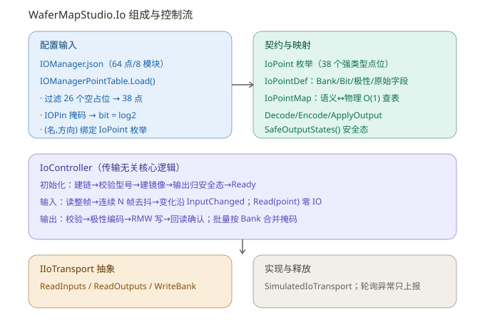

# 22 · IO 控制层工程实现：`WaferMapStudio.Io`

> 承接 16（IO 控制对象）、19（C# 控制方案），本篇是**已落地的实现说明**，不是提案。
> 源码：`src/WaferMapStudio.Io/`（net10.0 纯契约层），测试：`tests/WaferMapStudio.Io.Tests/`（21 用例全绿）。
> 点表来源：`E:\Data\Confs\IOManager.json`（8 模块 × 8 点 = 64 点，含 26 空占位、38 有效命名点）。

---

## 1. 功能范围与模块职责



本次实现覆盖 19 号方案的七项要求，落在独立的 net10.0 契约层（符合 AGENTS.md §2 依赖方向，不引用任何 UI/SDK）：

| 文件 | 职责 |
|---|---|
| `IoEnums.cs` | `IoPoint` 强类型点位（38 个）、`IoDirection`、`IoConnectionState`；每个枚举用 `IoPointBinding` 特性记录点表源名+方向 |
| `IoModels.cs` | `IoPointDef`（Bank/Bit/极性/点表原始字段）、`IoConnectionOptions`、`IoDeviceIdentity`、事件参数 |
| `IoExceptions.cs` | `IoControllerException` 基类 + 校验/点表/链路/写校验/型号不符 5 类派生异常 |
| `IoPointMap.cs` | 语义点 ↔ 物理地址唯一映射；`Decode`/`DecodeOutput`/`EncodeOutput`/`ApplyOutput`/`SafeOutputStates` |
| `IOManagerPointTable.cs` | 把真实 `IOManager.json` 解析为 `IoPointMap`，含掩码换算、同名区分、一致性校验 |
| `IIoTransport.cs` | 传输契约：读输入帧/读输出帧/按掩码写字节组；真机适配器与模拟器共用 |
| `IIoController.cs` | 上层唯一依赖的意图级契约 |
| `IoController.cs` | 传输无关核心逻辑：状态机、去抖、事件、批量写、回读确认、轮询、安全态 |
| `SimulatedIoTransport.cs` | 可注入故障的软件模拟器 |
| `IoControllerFactory.cs` | 集中装配，供 DI 单点注册 |

**不做（明确边界）**：真机 Modbus/EtherCAT/IPC 适配器（型号协议待确认）、安全联锁的写控制（只读、走独立硬回路）、高速 PSO 触发（属运动层）。

---

## 2. 点表解析：从真实 JSON 到强类型点位

真实点表关键特征与处理规则：

- **IOPin 是位掩码**（1/2/4…128），不是线性通道号。加载器用 `BitOperations.TrailingZeroCount` 换算为 bit 0–7，并校验必须是 2 的幂（非法值抛 `IoPointTableException`）。
- **同名点按方向区分**：`DoorLock1` 同时是输入（`IN_1`，门锁状态）和输出（`OUT_1`，门锁控制）。绑定键是 `(IOParameterName, IoDirection)` 二元组，分别映射到 `DoorLock1Status` / `DoorLock1Control`。
- **空占位过滤**：26 条 `IOParameterName=null` 的点位跳过，剩 38 个有效点。
- **一致性校验**：`IOName` 的模块前缀必须与 `IOModule` 一致、位号必须与 `IOPin` 换算结果一致；Bank 必须连续、地址不得重复、未知点位直接失败——宁可启动报错，也不要静默错位导致控错 IO。

映射结果：`IoPointMap.InputBankCount = 4`、`OutputBankCount = 4`（对应 IN_1…4 / OUT_1…4 每个模块一字节）。

---

## 3. 关键流程

### 3.1 初始化
`InitializeAsync` → 建链读身份 → 型号校验（ExpectedModel 非空时大小写不敏感比对）→ 校验设备帧长度 ≥ 点表 Bank 数 → 建立输入镜像并 seed 稳定值（不触发事件）→ **全部输出置安全态** → `Ready`。任一失败转 `Faulted` 并抛本层异常。

### 3.2 输入读取与去抖
`ReadInputsAsync` 批量读整帧 → 拷贝进 `_inputFrame` → 对每个输入点做"连续 N 帧一致才认"的去抖（N=1 等价于不去抖）→ 只有稳定值改变才发 `InputChanged`。业务侧 `Read(point)` 直接查 `_stableValues`，**零 IO 开销**。

### 3.3 输出控制
`WriteAsync`/`WriteBatchAsync`：方向校验 → `EncodeOutput`（低有效点取反）→ read-modify-write 只改目标位 → 回读 `ReadOutputsAsync` 确认逻辑值一致，不一致抛 `IoWriteVerifyException`。批量写先全量校验再按 Bank 合并掩码，一字节一次下发，减少往返。

### 3.4 轮询与异常
`StartMonitoringAsync` 用 `PeriodicTimer`；重复调用先停旧循环。**循环内异常只经 `Faulted` 上报、不退出循环**，故障清除后自动恢复——避免设备"静默失明"。取消令牌原样抛出，便于区分"用户取消"与"真故障"。

### 3.5 资源释放
`DisposeAsync`：停轮询并等待任务结束 → 输出归安全态 → 断开传输 → `SuppressFinalize`。重复调用幂等。

---

## 4. 需要配置的参数与依赖

- **依赖**：仅 .NET 10 内置 `System.Text.Json`；无 NuGet 包、无厂商 SDK。项目已加入 `E142Transfer.slnx` 的 src/tests 分组。
- **点表**：`IOManager.json` 路径传给 `IOManagerPointTable.Load(path)`。若产线点表增减点位，需同步更新 `IoPoint` 枚举的 `IoPointBinding`——未绑定点会启动失败（故意设计，防止漏控）。
- **连接参数**：`IoConnectionOptions(Kind, Address, Port, Timeout, ExpectedModel)`。当前工厂仅 `Simulator` 可用；`Tcp/Fieldbus/OutOfProcess` 显式抛"适配器未实现"，避免误用。
- **低有效点位**：真实点表无有效电平字段，`ActiveLow` 默认 false。若现场有常闭（NC）点，需在 `IoPointDef` 构建后按电气图纸调整该字段——这是**待现场确认项**。
- **去抖帧数**：`IoController(transport, debounceFrames)`，默认 1；按现场信号抖动程度调整。

---

## 5. 验证方式

```
# 全解决方案构建（应 0 警告 0 错误）
dotnet build E142Transfer.slnx -c Release

# 全部测试（Io 层 21 用例）
dotnet test E142Transfer.slnx -c Release

# 自检闭环
dotnet run --project tests/E142Transfer.SelfTest -c Release
```

本次实际结果：

| 项目 | 结果 |
|---|---|
| 构建 | 0 警告 0 错误（15 项目） |
| Core 42 / Lighting 15 / ViewModel 17 / **Io 21** / Motion 19 | 全绿，0 失败 |
| SelfTest | 全部自检通过 |

21 个 Io 用例覆盖：空占位过滤、位掩码换算、同名点方向区分、非法 IOPin（3/0/256）、IOName 位号冲突、未知点位、地址重复、极性解码、安全态、初始化/型号校验/未就绪、按位读、写回读、写输入点校验、批量写、写校验失败、去抖、轮询异常上报且循环存活、释放安全态。其中"真实点表文件存在时"用例在本机读取 `E:\Data\Confs\IOManager.json` 验证 38 点/4+4 Bank/关键物理位置；文件不存在时自动跳过，不依赖外部文件。

---

## 6. 后续待办（需现场输入）

1. 确认 IO 模块型号与协议，实现 `IIoTransport` 的真机适配器（Modbus TCP 或进程外桥接），在 `IoControllerFactory` 接入对应 `IoConnectionKind`。
2. 按电气图纸补齐低有效（NC）点位的 `ActiveLow`。
3. 在 `AppServices.cs` 注册 `IIoController`（DI 单点），接入检测流程的就绪握手与拍照触发分支。
4. 确认 `OUT_1.5:IO拍照` 是低速单帧触发还是主触发源——高速飞拍应走运动层 PSO。

> 按 AGENTS.md 检查清单，本次版本未改动（版本号仍为 `Directory.Build.props` 中的 0.2.2）；提交时用中文 Conventional Commits 并尾注版本号。
