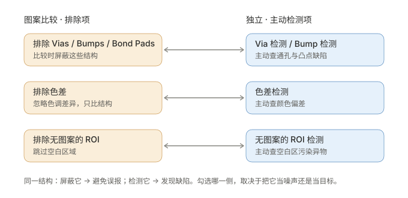

# 23 · AOI 检测模式术语解析

> 本文整理自一张 AOI（自动光学检测）设备的检测模式勾选清单。清单共 16 个勾选项：10 个独立检测模式，加上"图案比较测试"这个父项及其下 5 个过滤子项。
>
> 所有条目按"术语 — 含义 — 上下文作用"整理，并补充全称、常见译法、与相近概念的区别；多义术语明确当前语境下应取的含义。

---

## 0. 全局关系：排除项 vs 主动检测项

清单里最容易看反的一点是：**同一个对象（色差、无图案 ROI、Via/Bump）既可以是主动检测目标，也可以是图案比较时要屏蔽的干扰项**，两者方向完全相反。

> 图 23-1：左侧为图案比较中的"排除"子项（屏蔽以避免误报），右侧为独立的"主动检测"项（查找缺陷），同一结构对象在两种模式下被反向处理。

---

## 1. 维度类

| 术语 | 含义 | 上下文作用 |
|---|---|---|
| **2D 检测** | 基于灰度/彩色图像的平面检测，提取亮暗、边缘、颜色、纹理等二维特征 | 与 3D 检测并列的基础模式，覆盖图案缺陷、污染、划伤等；成本与数据量低 |
| **3D 检测** | 通过白光干涉、共聚焦或结构光重建高度图（Z 向形貌） | 用于量测 bump 高度、共面性、翘曲、焊点立体形状；2D 无法给出高度信息 |
| **Die（晶粒）** | 晶圆上经切割后得到的单个芯片单元 | "部分 Die 测试"的计量单位，也是多数检测结果的归属对象 |

---

## 2. 区域与结构类

| 术语 | 含义 | 上下文作用 |
|---|---|---|
| **切割道检测**（Scribe line / Dicing street） | 对 die 之间用于切割分离的窄条空白区做检查 | 切割道易残留金属、产生崩边/裂纹，且无图案可参照，通常需独立的检测策略 |
| **Via（导通孔 / 通孔）** | 连接芯片上下层金属的垂直互连结构，全称 Vertical Interconnect Access | 在"排除项"中是被屏蔽的对象；在"Via 检测"中是主动检测目标（开路、堵塞、电阻异常） |
| **Bump（凸点 / 凸块）** | 芯片与基板互连用的金属凸起（solder / Cu pillar / Au bump） | 倒装封装的核心互连，需测高度、共面性、桥连；同样兼具"被排除"与"被检测"双重身份 |
| **Bond Pad（焊盘 / 键合垫）** | die 表面供引线键合或凸点连接的金属区域 | 形状规则、反光强，在图案比较中容易造成伪差异，常被列入排除 |
| **无图案的 ROI 检测** | 对无明显图案的感兴趣区域（空白区、切割道周边、边缘区）主动查找异物、污染、残留 | 与"排除无图案的 ROI"正好相反：前者把空白区当检测目标 |
| **ROI**（Region of Interest，感兴趣区域） | 图像中划定的一块待处理子区域 | 所有"排除/检测 ROI"选项的作用范围限定符；缩小 ROI 可减少计算量、抑制误报 |

---

## 3. 图案比较测试及其 5 个子项

**图案比较测试**（Pattern comparison / Golden die comparison）：把待测 die 的图像与"标准 die"或模板逐像素比对，差异超阈值即判缺陷。这是 AOI 的主流算法之一。它下面的 5 项都是**比较时的过滤与范围设定**，不是独立检测任务：

| 术语 | 含义 | 上下文作用 |
|---|---|---|
| **部分 Die 测试** | 只取 die 的一部分区域参与比较，或只测部分 die 样本 | 缩小比较范围、加快速度；也用于边缘不完整 die 或抽样快速验证 |
| **排除 Vias、Bumps 和 Bond Pads** | 比较时屏蔽这三类互连结构所在的像素 | 它们本就因工艺波动而形态各异，参与比较会产生大量伪缺陷 |
| **排除一致性** | 屏蔽图案高度一致、无特征变化的区域（如平坦背景） | 一致区域不含可判别信息，比较无意义且易受噪声干扰；只保留有特征变化的区域 |
| **排除色差** | 比较时忽略色调/明度差异，只比几何与结构 | 光照、镀层厚度波动会造成整体色偏，屏蔽后显著降低误报（但会漏掉纯色差类缺陷） |
| **排除无图案的 ROI** | 把空白、无纹理的 ROI 从比较中剔除 | 与"无图案 ROI 检测"互斥；空白区没有参照图案可比，强行比较只会制造噪声 |

---

## 4. 成像质量与量测类

| 术语 | 含义 | 上下文作用 |
|---|---|---|
| **统一检测**（Uniform inspection） | 对整片或整幅图用统一参数、统一阈值执行一次检测，不分区分项目差异化配置 | 简化配方、保证判据一致；与"分区/分项目检测"相对。当前语境下取此义，而非"均匀性检测" |
| **离焦检测**（Defocus detection） | 检测图像因焦面偏移而模糊的程度，用于监控光学系统或样品台面的高度偏差 | 离焦会让细小缺陷漏检；作为成像质量的前置校验项，而非直接找产品缺陷 |
| **色差检测** | 主动检测颜色偏差（镀层色差、氧化、异物导致的色调异常） | 与"排除色差"反向：把颜色本身当作缺陷信号来查 |
| **临界尺寸检测**（CD, Critical Dimension） | 对关键特征尺寸（线宽、间距、孔径、bump 直径等）做精密量测 | 确定图形是否符合设计规则、监控工艺漂移；属于量测（metrology）而非单纯的缺陷分类 |

---

## 5. 多义与易混点提示

- **排除色差 vs 色差检测**：前者是把色差当噪声丢弃，后者是把色差当缺陷寻找。两者通常二选一，同时勾选逻辑上矛盾。
- **排除无图案的 ROI vs 无图案的 ROI 检测**：同一区域，一个屏蔽一个主动查，互斥。
- **Via/Bump 的双重身份**：在图案比较中作为"排除项"出现，在独立检测中作为"检测项"出现——前者防误报，后者查开路/桥连/高度异常。
- **统一检测**：在部分设备语境里也可能指"均匀性检测"（uniformity），但本清单与"离焦检测""色差检测"并列，指的是统一阈值的整体检测模式，此处按后者理解。
- **临界尺寸检测**：不要与一般缺陷检测混淆，它输出的是**尺寸数值**，用于 SPC 与工艺监控，而非 pass/fail 分类。

---

## 6. 与本项目其他文档的关系

- 光学成像链（相机/镜头/光源/滤光片）见 [17 · AOI 光学成像](./17-AOI光学成像-相机镜头光源与滤光片.md)；本文的"离焦/色差/2D/3D"是那条链路在**检测模式层面**的对应概念。
- AOI 缺陷级数据的落地与 die 级 bin 的推导见 [14 · KLARF 真实样本解析](./14-KLARF-AOI缺陷清单样本解析.md)。
- 本文的 Via/Bump/Bond Pad 属先进封装互连结构，是 AOI 在封装段的典型检测对象，与芯粒/晶圆级的 die-bin 模型互为补充。
